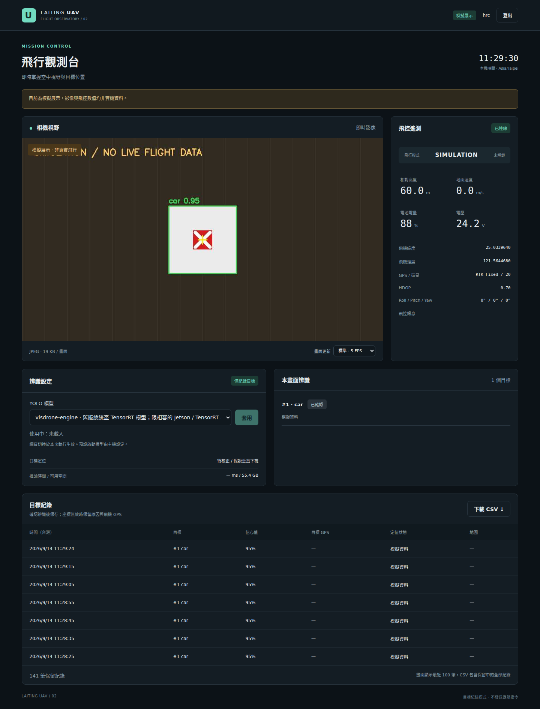

# LAITING UAV V2

專案位置：`/home/hrc/laiting_uav`。沿用 G3P RTSP 相機、ALIGN AP6 飛控、總統盃 VisDrone YOLO 模型，提供帳密登入的網頁地面站、壓縮影像、飛控遙測、目標 GPS 事件與模型切換。目前預設總統盃 v5 模型（`president-cup-v5`），支援民用車、輕型／中型戰術車、雲豹裝甲車與兩棲突擊車。

**辨識到目標只寫入紀錄，不發送返航、解鎖、航點或飛行模式指令。** 唯一送往飛控的命令是要求遙測訊息更新率。

## 開始使用

本機已建立虛擬環境、兩個網頁使用者 `laiting`、`hrc`，密碼依本次需求設定。密碼只以加鹽 scrypt 雜湊存在 `config/users.json`，不寫入文件或程式碼。

```bash
cd /home/hrc/laiting_uav
# 實機服務狀態、重新啟動、追蹤日誌
systemctl --user status uav-v2
systemctl --user restart uav-v2
journalctl _SYSTEMD_USER_UNIT=uav-v2.service -f

# 環境與連線診斷
.venv/bin/python scripts/manage.py doctor
```

網域上線後，瀏覽 `https://uav.laiting1202.com` 即可登入。網頁 origin 固定 HTTPS，服務只監聽 `127.0.0.1:8080`，由 Cloudflare Tunnel 轉送。

無硬體時，可在主機瀏覽 `http://127.0.0.1:8081` 查看明確標示的模擬展示。模擬模式使用獨立資料庫，影像／GPS／辨識結果均為合成資料。若展示未啟動：

```bash
.venv/bin/python -m uav --demo
```

這次驗證用的暫時展示服務可以停止：`systemctl --user stop uav-v2-demo`。它不會在下次開機自動啟動。



## 五項需求的對應

| 需求 | 實作 |
| --- | --- |
| 程式與資料位置清楚 | [完整檔案索引](docs/FILES.md)，單一主設定 `config/settings.json`；沒有匯入舊專案執行路徑 |
| Cloudflare 網頁、影像、飛控、帳密 | FastAPI 網頁，1／2 FPS JPEG 預覽，受保護的 MJPEG API、遙測、CSV，scrypt／session／CSRF／登入限速 |
| Cloudflare SSH、連網重連 | 獨立 Tunnel 與應用 systemd 服務，`ssh-uav.laiting1202.com`，開機常駐、異常重啟；[部署與 SSH](docs/DEPLOYMENT.md) |
| 目標 GPS 紀錄、不返航 | 辨識到目標即保存完整視野 JPG、框、時間、類型、目標經緯度（WGS84）與 TWD97；可逐筆下載及一鍵清除，無法定位時標明原因 |
| 模型集中、方便切換 | `models/president_cup_v5/best.pt` 是目前預設；另提供 `competition-5class-v1-3` 與 `competition-5class-v4finetune`；網頁可切換本次使用模型，本機指令可設定下次啟動模型 |

## 即時地圖與飛行軌跡

「即時飛行地圖」每秒依飛控有效 GPS 更新飛機位置，可拖曳、縮放、勾選「跟隨飛機」或按「查看完整軌跡」。飛控離線、GPS 未達 3D 或資料過期時，最後位置會變灰並標示非即時。

在地圖旁的「飛行數據」操作：

1. 按 **開始紀錄**，主機每秒保存有效 GPS；預設不紀錄。可在等待 GPS 時開始，定位恢復後才新增點。
2. 按 **停止紀錄**，結束並保存本次軌跡。地圖保留完整路線、起點及終點。
3. 按 **下載軌跡 JPG ↓**，下載 1400×1000 的完整航線地圖，附起終點、台灣時間、點數、已紀錄距離及地圖出處。匯出範圍不受目前地圖縮放或手機螢幕大小影響。

[JPG 匯出範例（模擬軌跡，非真實飛行）](docs/flight-track-example.jpg)。

軌跡由主機保存，切換分頁、關閉網頁或重新整理不會停止紀錄；須按「停止紀錄」才結束。多個登入頁面共用同一架飛機的紀錄狀態。開始下一次紀錄後，仍可下載最近一次已完成軌跡。沒有有效 GPS 點的紀錄不提供 JPG。GPS 缺失、飛控重新連線及取樣長時間中斷會分段，缺失區間不連線，也不加入距離。

服務重啟會結束當次紀錄並保留已保存的點，下次需重新按開始；不會默默繼續上一趟。資料存在 `data/live/flight-tracks.sqlite3`；模擬資料在 `data/demo/flight-tracks.sqlite3`，匯出另標示模擬。辨識區的「清除全部紀錄」只清除目標事件，不刪除飛行軌跡。

底圖及含底圖的 JPG 匯出需要連網至 OpenStreetMap；底圖無法載入時仍保存有效 GPS，匯出失敗會提示重試。Leaflet 1.9.4 程式與樣式放在本機，JPG 在瀏覽器產生，不需額外金鑰或套件。[Leaflet 官方文件](https://leafletjs.com/reference.html)、[OpenStreetMap 圖磚使用規範](https://operations.osmfoundation.org/policies/tiles/)。

## 主要設定

修改 `config/settings.json` 後執行 `systemctl --user restart uav-v2`。

| 欄位 | 現有設定與功能 |
| --- | --- |
| `camera.source` | `rtsp://192.168.144.135/live`；也支援 `/dev/video0` 與本機影片 |
| `camera.width/height/fps` | 原生 1920×1080、4 FPS 取樣送入模型（每幀 250 ms）；每次連線確認來源尺寸，不放大低解析度串流；只保留最新一幀，推論較慢時跳過中間影格 |
| `camera.refresh_s` | 每 240 秒重建 RTSP session，避開相機約 8–11 分鐘後停止傳送的韌體問題 |
| `camera.g3p_settings` | 相機上線時套用 1080p/30、EIS 關閉、1080p 次串流固定 2 Mbps，以穩定優先；不自動升到最高碼率 |
| `preview` | 960 寬、最高 2 FPS、JPEG 品質 55；GUI 預設 2 FPS，也可選 1 FPS；壓縮只影響預覽，不縮小送 YOLO 的原始畫面 |
| `telemetry.connection/baud` | 舊版飛控 USB by-id 路徑、115200，自動重連 |
| `telemetry.usb_serial` | 固定這台 AP6 的 USB 序號；重新插接時再次查找，即使 ttyACM 編號改變也可找到同一台設備 |
| `telemetry.system_id/component_id` | 已確認 AP6 為 1／1；不接受轉送的地面站心跳作為飛控 |
| `detection.vehicle_conf` | 新目標預設 0.45；網頁可調整 1–100%，套用後下一次推論生效並保存，重啟保留；車輛類別由模型 registry 設定 |
| `detection.track_conf/track_ttl_s` | 既有同類目標可用 0.10 信心續追；漏檢後最多保留 0.35 秒，橘色 HOLD 表示上次觀測框；兩項均可在 GUI 調整並保存 |
| `detection.white_ratio/red_ratio` | 0.30／0.015，用於選擇車頂標記定位點；未通過的車輛仍會記錄，以框中心定位 |
| `detection.roof_red_fallback` | true：以白車車頂紅色區塊作為備援定位點；所有模型車輛類別都可觸發紀錄 |
| `detection.record_after_s` | 0.0 秒，首次辨識就紀錄；同類目標以 IoU 一對一追蹤，同一連續追蹤將有可能的類別各記一筆，最多 5 筆；0.35 秒內恢復不重複記錄，追蹤到期後重新辨識才新增紀錄；保留框不新增紀錄或定位 |
| `geolocation.orientation_source` | `assumed_nadir`：依使用者目前要求，假設鏡頭朝地面垂直下視，影像上方跟隨機頭；紀錄標示為假設推估 |
| `geolocation.calibrated` | false：使用舊程式焦距估值推算，明確標示鏡頭未校正；見[定位與校正](docs/GEOLOCATION.md) |
| `geolocation.min_gps_fix` | 3：接受一般 3D GPS，RTK Float／Fixed 也可定位；紀錄保留定位等級 |
| `geolocation.estimated_focal_ratio` | 0.9：未校正時採用 `fx=fy=0.9×影像寬度`；null 則停用內參估算 |
| `geolocation.assume_ground_at_takeoff` | true：無測距／指定地面高度時，假設目標地面與起飛點同高 |
| `storage.max_events` | 保留最近 10,000 筆；超過後逐筆淘汰最舊事件 |
| `storage.min_free_mb` | 低於 512 MB 時停止寫入並在網頁顯示失敗，避免默默漏記 |

2026-10-10 依約 200 ms 的模型推論時間改為穩定優先：Jetson 從 RTSP 取樣 4 FPS，推論、紀錄及預覽編碼共用每幀 250 ms 的處理預算，每輪至少休息 50 ms；處理較慢時降低實際 FPS，下一輪直接取最新影格，不補跑錯過的影格。GUI 編碼與抓圖上限降為 2 FPS。相機端仍為 1080p/30、2 Mbps，因此此調整主要減少 Jetson 的影格輸出／處理負載與 GUI 傳輸量。

## 切換模型與修改密碼

```bash
# 列出模型
.venv/bin/python scripts/manage.py model
# 修改「下次啟動」模型，然後重啟
.venv/bin/python scripts/manage.py model president-cup-v5
systemctl --user restart uav-v2
# 切換競賽五類 v4 微調模型（1152 輸入尺寸）
.venv/bin/python scripts/manage.py model competition-5class-v4finetune
systemctl --user restart uav-v2
# 切換舊 VisDrone TensorRT（非 v5 五類模型）
.venv/bin/python scripts/manage.py model visdrone-engine
systemctl --user restart uav-v2
# 互動式設定新密碼，不把密碼放進 shell history
.venv/bin/python scripts/manage.py user laiting
```

新增模型時，把可信來源的 YOLO 權重放入 `models/<組別>/`，在同一目錄的 `registry.json` 新增名稱、檔名、`imgsz`、`device`、`half`、`classes`、說明。網頁重新載入就會列出新模型。程式合併各組的 `registry.json`，包括 `models/president_cup_v5/registry.json`、`models/competition_5class_v1-3/registry.json` 與 `models/competition_5class_v4finetune/registry.json`；若有根目錄 `models/registry.json` 則優先使用它，否則合併各組清單並要求模型名稱唯一。載入新模型前會做一次 warmup；載入失敗會保留原模型並顯示錯誤。網頁切換只影響本次執行，避免把試用模型自動變成開機預設。

網頁「辨識設定」可使用滑桿或輸入百分比調整新目標最低信心值，並調整續追信心及漏檢保留秒數，再按「套用信心值」。新目標預設 45%、續追 10%、保留 0.35 秒；降低新目標門檻可能增加誤判。設定套用到所有模型，切換模型及重開機後保留；使用 `--config` 啟動時保存到該設定檔。框上 `raw` 是模型實際信心，HOLD 沿用上次信心，均不是辨識準確率。v5 實機輸入改為 `imgsz=1280`，完整設定與影片重播見 [辨識與追蹤](docs/DETECTION_TRACKING.md)。

「目標紀錄」會將同一個已辨識目標的各個可能類別分別保存為可下載 JPG／CSV 的紀錄，最多 5 筆，共用該次觀測的框、時間、追蹤 ID 與座標。可能類別採模型原始信心 **大於 0**，包括低於新目標／續追門檻的類別；各筆顯示自己的類型與信心，極小正值顯示 `<0.1%`。即時影像與本畫面辨識仍只顯示最高機率類別。每段連續追蹤保存一次候選組，續追與 HOLD 不重複保存。既有紀錄保留原內容；已內含 NMS、僅輸出最高分類別的匯出模型只能保存模型實際提供的類別。

## 換電池、重新連線與網頁重啟

網頁最上方的「連線與恢復」提供三個按鈕：

- **重新連線相機**：取消目前 RTSP 探測／解碼程序並重新建立串流；清除舊畫面，取得新畫面後自動顯示。
- **重新連線飛控**：關閉並重開本機 MAVLink 連線，依固定 USB 身分尋找設備；不重啟飛控硬體，也不發送飛行控制命令。
- **重啟影像辨識服務**：由 systemd 在兩秒後重新啟動 `uav-v2`，重新載入預設模型、相機及飛控。保留有效登入，網頁追蹤服務重啟、模型載入與影像恢復，完成後按鈕可再次操作；SSH Tunnel 獨立運作，既有目標紀錄保留。

設備斷電時不需要手動按按鈕：相機遇到 EOF 或 5 秒沒有完整影格時會重建串流；飛控 USB 消失或心跳超過 8 秒會斷開重連。RTSP 取像每秒重試，G3P 編碼器恢復失敗時，以 30／60／120／240／300 秒退避重試，最長間隔 300 秒，均沒有固定次數上限。RTSP 持續嘗試，因此相機重新上電後不必等控制退避結束才能接回畫面。連續三次 -21 拒絕會在網頁提示重新上電；收到有效影格後清除故障狀態。設備重新上電後仍要等硬體開機、RTSP／USB 出現，因此恢復秒數包含硬體啟動時間。

網頁登入採 **8 小時閒置逾時**（`web.session_hours`）：持續觀看會同時延長伺服器 session 和瀏覽器 cookie，即使相機暫時離線也能保持登入。關閉頁面／瀏覽器停止背景請求達 8 小時、修改密碼或登出後，仍需重新登入。有效登入以 token 雜湊及原有期限保存在 `data/live/sessions.json`（示範模式為 `data/demo/sessions.json`），權限 600；重啟服務會恢復登入與 CSRF，登出／密碼變更仍能撤銷。短暫網路逾時會持續重試；首次登入資訊讀取失敗不阻止影像與遙測更新，紀錄／模型清單也會獨立重試。收到 401 時會再確認登入狀態，只有伺服器確認登入失效才返回登入頁並說明原因。

畫面會顯示連線階段、成功連線次數、最近成功時間、相機接收 FPS 和錯誤原因。電池供電若只切掉飛控外部電源但 USB 還供電，飛控可能不會真正斷線；這與完整 USB 拔插是不同測試。

**相機使用 Ethernet／RTSP；USB 只用於飛控。** Ambarella H2 韌體實測會在單一 RTSP session 約 8–11 分鐘後停止送影格；降低編碼負載後仍會發生，`RESETVF` 有時可以自動恢復；持續回覆 -21 時仍需相機重新上電。服務現在每 240 秒重建 FFmpeg／RTSP session，期間保留最後影格；這只能緩解問題，2026-09-21 實測在多次成功重連後仍可能卡死。若仍有 5 秒影格逾時，再透過 TCP 7878 執行 `RESETVF/none_force`。服務啟動或相機恢復時也會套用 1080p/30、關閉 EIS、維持 1080p 次串流及固定 2 Mbps，逐項回讀確認。2026-10-09 依使用者要求以穩定優先，取消原本的 1 Mbps 設定，但不升到相機支援的最高 5 Mbps。正常取像期間控制 socket 保持關閉，關閉時不送會終止 RTSP 的 `STOP_SESSION(258)`。若相機網路堆疊不回應，或網路正常但編碼器持續回覆 -21，現有軟體控制無法保證恢復，需由相機供電端重新上電。辨識、紀錄及預覽的畫質區別見 [影像品質檢查](docs/IMAGE_QUALITY.md)。

服務亦啟用 systemd watchdog：即使設備離線，只要重連迴圈持續運作就不重啟；影像／飛控工作執行緒或網頁事件迴圈長時間卡死而無法回報 watchdog 時，systemd 會自動重啟應用。主機重新上電後，原有 Linger 與 enabled 服務會自動啟動。

Cloudflare Tunnel 會等待開機網路初始化，並持續監看上網出口。Wi-Fi／行動網卡切換、來源 IP 或閘道改變時，自動重建 Tunnel，避免服務顯示執行中但網站回 1033、SSH 無法連入。只更新這部分可執行 `.venv/bin/python scripts/services.py --tunnel-only`；詳見[開機與網路恢復](docs/DEPLOYMENT.md#本機服務)。

2026-10-05 針對畫面停止更新時的外網／DNS 異常，Tunnel 改用獨立的雙 DNS 設定，加入公開網頁健康檢查，正常檢查間隔縮短為 15 秒；同一項公網檢查連續三次失敗且本機服務正常時，自動重建 Tunnel。本機辨識、飛行紀錄與 SSH／網頁連線服務分開運作。[追查、驗證與限制](docs/INCIDENT_2026-10-05.md)。

同日 15:51 飛行中再次失聯後，進一步加入重建前的 DNS／HTTPS 上游檢查：上游也故障時保留 Tunnel，恢復後仍異常才重建；HTTP 健康檢查增加 HTTPS DNS 備援。獨立的 `uav-network-health.service` 持續保存 UDP／TCP DNS 與不依賴一般 DNS 的 HTTPS 結果。目前只有一條已連線的行動外網，仍未排除網卡／電信路徑問題，不能承諾飛行中零斷訊。[本次故障與修正](docs/INCIDENT_2026-10-05_1551.md)。

後續已啟用持續自動恢復：DNS 修復、固定行動網卡重新連線、USB reset 與指定網卡驅動重新綁定依階段重試；退避最長 300 秒，沒有總次數上限。DNS 新增本機 UDP／TCP 解析器及 HTTPS 備援，恢復服務／Tunnel 有 watchdog。恢復操作不變更相機 Ethernet `eno1`。設備重新出現或上游恢復後持續自行接回。[現行流程與驗證](docs/NETWORK_RECOVERY.md)。

2026-09-22 再次斷線時確認行動網卡在約 96 秒內 USB 脫離 21 次。現已加上同一路由恢復後立即檢查、SSH 失敗每 5 秒複查，以及獨立的持久網路紀錄服務；這些可縮短卡住後的恢復等待，無法阻止 USB 硬體掉線。現場沒有已連線的 Wi-Fi 備援；網卡、接頭及供電仍需檢查。[本次追查與驗證](docs/INCIDENT_2026-09-22.md#再次斷線追查與補強1632–1639)。

上網預設以 DWM-222W 行動網卡優先（route metric 100），既有 Wi-Fi 為備援（600）。網卡已設定開機自動連線與持續重試，不需先登入桌面；網卡較晚上線時，Tunnel 會持續等待並自行啟動。

終端機備援操作：`systemctl --user restart uav-v2`。本版網頁重啟範圍是影像辨識服務，沒有重開整台 Linux 主機或飛控硬體的按鈕。

## 安裝與驗證

此機採 Jetson NVIDIA CUDA PyTorch；`.venv` 使用 `--system-site-packages` 保留原來的 torch、torchvision、TensorRT、OpenCV。不要用一般 PyPI CPU 版 torch 覆蓋 Jetson 環境。

```bash
bash scripts/install.sh
.venv/bin/python -m pip install -r requirements-test.txt
PYTEST_DISABLE_PLUGIN_AUTOLOAD=1 .venv/bin/python -m pytest -q tests
```

測試涵蓋登入邊界、session 撤銷、CSRF、限速、目標確認、事件持久化、實際 FFmpeg 斷流重連、MAVLink 訊息來源隔離、鏡頭／雲台座標轉換與 GPS 時效。[本次驗證結果](docs/VALIDATION.md) 清楚列出已測項目與待實機確認部分。
