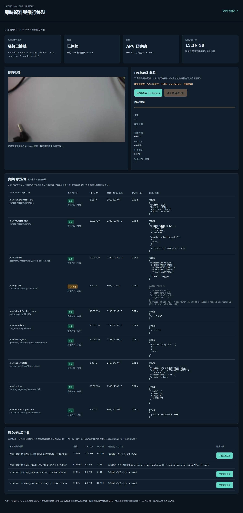
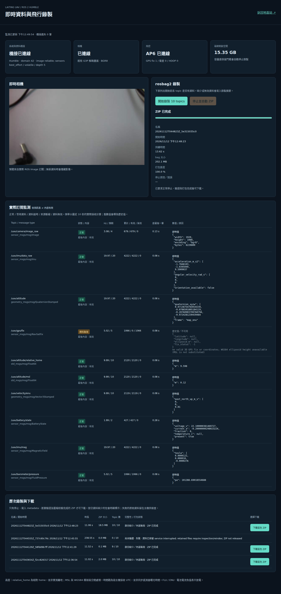
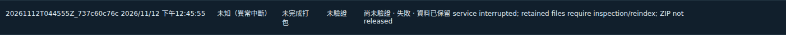

# 實機驗收紀錄 — 2026-11-12（Asia/Taipei）

已完成部署並實際操作，但**尚未全部驗收通過**：GPS 沒有有效定位與可確認的 WGS84 橢球高；另一台實體 DDS 接收端與整台 Ubuntu 重開機尚未測試。不得把這些項目視為成功。

## 執行環境與結果範圍

Jetson arm64、Ubuntu 22.04.5、kernel 5.15.185-tegra；ROS 2 Humble；G3P RTSP 相機 1920×1080、宿主機取樣 4 FPS；AP6 USB by-id，MAVLink system/component 1/1，115200 baud。原有 `uav-v2`／Cloudflare／GPU 推論保持使用。新增 Docker gateway 以 domain 42 運作，發布與監測十個固定型別；Image reliable，其他小型感測訊息 best_effort，均 volatile。使用 host network + host IPC／128 MiB Fast DDS SHM segment，跨機保留 UDP。

11/12 該次驗收的映像：`sha256:0df8cc014f413396d1b325a1c082263809b2ead5f13aae5945c93c3836562374`；目前部署映像另見 [image.lock](image.lock)。宿主機 NTP 檢查為已同步；header 仍是接收 UTC，不宣稱感測器硬體同步。

## 持續訂閱與內容抽查

下表來自最後一次 20 秒實際訂閱，包含容器中獨立探針與宿主機的獨立原生 ROS 探針；全部 topic 都收到至少三筆，且首末接收跨度至少覆蓋測試時間一半。不是以 `ros2 topic list` 判定。實測 Hz 不等於設定／要求 Hz；Image 受完整影格複製、發布與訂閱負載影響，約 3.2 Hz，來源取樣上限為 4 Hz。

| Topic | Type | Hz（容器 / 宿主機） | 宿主機接收數 | 有效 / 無效數 | 驗收 bag 筆數 |
| --- | --- | --- | --- | --- | --- |
| `/uav/camera/image_raw` | `sensor_msgs/msg/Image` | 3.17 / 3.22 | 63 | 63 / 0 | 34 |
| `/uav/imu/data_raw` | `sensor_msgs/msg/Imu` | 19.71 / 19.17 | 371 | 371 / 0 | 222 |
| `/uav/attitude` | `geometry_msgs/msg/QuaternionStamped` | 19.82 / 19.17 | 372 | 372 / 0 | 221 |
| `/uav/gps/fix` | `sensor_msgs/msg/NavSatFix` | 4.94 / 4.69 | 91 | 0 / 91 | 56 |
| `/uav/altitude/relative_home` | `std_msgs/msg/Float64` | 9.91 / 9.69 | 188 | 188 / 0 | 110 |
| `/uav/altitude/msl` | `std_msgs/msg/Float64` | 9.91 / 9.69 | 188 | 188 / 0 | 110 |
| `/uav/velocity/enu` | `geometry_msgs/msg/Vector3Stamped` | 9.91 / 9.69 | 188 | 188 / 0 | 111 |
| `/uav/battery/state` | `sensor_msgs/msg/BatteryState` | 2.00 / 2.01 | 39 | 39 / 0 | 23 |
| `/uav/imu/mag` | `sensor_msgs/msg/MagneticField` | 19.83 / 19.28 | 373 | 373 / 0 | 222 |
| `/uav/barometer/pressure` | `sensor_msgs/msg/FluidPressure` | 4.94 / 4.69 | 91 | 91 / 0 | 56 |

探針期間：2026-11-12T12:58:35+08:00 至 2026-11-12T12:58:55+08:00。原始報告：[宿主機](validation/host-probe.json)、[容器](validation/container-probe.json)、[實際 MAVLink 抽樣](validation/source-samples.json)、[解壓後逐筆驗證](validation/downloaded-bag-validation.json)。

- GPS：fix_type=1、satellites=0；NavSatFix.status=-1，經緯度及橢球高 NaN（GUI JSON 為 null）。封包未提供可確認的 alt_ellipsoid。沒有把 (0,0) 當有效定位、沒有拿 MSL 代填。GUI 的接收數持續增加，但狀態為資料無效。
- IMU：有真實三軸加速度與角速度；orientation_covariance[0]=-1，orientation=(0,0,0,0) 為不可用，不是假姿態。另一路 attitude 來自飛控實際估計並轉換為 FLU→ENU。
- 相對 home、MSL、速度均來自 GLOBAL_POSITION_INT 各自定義的欄位，沒有以相對 home 當 AGL；MSL 是飛控估計值，沒有進行獨立大地高程或感測器精度校正。
- 磁場是 SCALED_IMU milliGauss→Tesla，氣壓是 SCALED_PRESSURE hPa→Pa。AP6 回覆不支援 HIGHRES_IMU，最終預設只要求已收到的 SCALED_IMU／SCALED_PRESSURE。
- 電壓／電流來自 SYS_STATUS；電流轉為 ROS 放電負值。AP6 此時回報 0% 電量，按來源保留，沒有做另一次 SOC 估測或校準。未知溫度、容量等為 NaN。
- 「內容有效」表示協定欄位、單位、有限值、必要可用性及時間檢查通過；並非對 GPS／高度／姿態／電池的物理精度作出保證。

## GUI 與完整錄製流程

由實際 Chromium 經 **https://uav.laiting1202.com/** 登入原網站，再進入 `/ros2/` 操作。使用短暫隨機測試帳號，測試後已移除，沒有更動既有帳號密碼。

[完整瀏覽器報告](validation/browser-full-report.json) 證明：十項接收數增加、相機預覽、GPS 無效狀態、開始→停止→驗證→ZIP→選擇下載、兩種歷史 ZIP 的選取與 SHA 比對、開始與停止重複請求回 409、區網 8090 使用原帳號登入、行動版版面及無 JS 錯誤。最後的 [介面檢查](validation/browser-smoke-report.json) 另確認最新 GUI 的開始前缺少資料提示與即時預覽。

真實故障注入：暫移唯一來源 Unix socket，GUI 顯示來源斷線並隱藏舊影像；還原後接回。瀏覽器離線六秒時，保留值改為非即時、正常標記移除；恢復後再次更新。topic 等待／逾時／斷線／無效的差異另有單元測試；沒有刻意關閉 AP6 遙測來干擾既有飛控連線。

相機曾回覆 RTSP 404，G3P 控制連續逾時；**使用者重新上電後才恢復**，後續完成含相機的錄製。Docker 沒有修復這個相機韌體／供電故障，也不能承諾不用重新上電。另一包在相機斷線時錄得的九 topic 資料仍保留且標成 partial，沒有假影像。

## 下載、校驗及回放

實際下載的驗收包：`20261112T044823Z_5e315035c0.zip`，19,375,654 bytes。ZIP SHA-256 與伺服器相符，解壓後 `sha256sum -c SHA256SUMS` 的每個項目均通過；包含完整 bag、metadata、README、摘要、環境、套件鎖定、建置來源雜湊與 recorder log。

`ros2 bag info`：sqlite3，10 topics，1,165 筆，資料時間跨度 11.062375349 秒；起點 `1794458905925931938`、終點 `1794458916988307287`（Unix ns，約台灣時間 12:48:25.9259–12:48:36.9883）。[完整輸出](validation/downloaded-bag-info.txt)；SQLite integrity、每筆 CDR、topic/type、metadata 訊息數與時間範圍已核對。GPS 無效，所以包為 **partial**，不是完整有效十項資料。

以獨立 domain 91，使用宿主機 `ros2 bag play --clock --rate 0.5 --wait-for-all-acked 10` 回放下載後的 bag；宿主機及 Docker 各自訂閱，十種訊息均收到。兩端均收到 **34/34 筆影像**。[逐 topic 回放結果](validation/replay-result.json) 列出原包筆數與兩端實收數。其他 best_effort topics 在此回放有少量未接收，沒有宣稱逐筆無損；檔案中的筆數已由 metadata／SQLite 精確核對，兩者是不同檢查。

下載檔、解壓目錄、每包原始檔及所有完整測試證據留在 `data/ros2/`；大體積 bag/ZIP 不加入 git。可由 GUI 自行選取下載，不需搬移檔名。

## 中斷、持久化與開機服務

[實際重啟報告](validation/restart-report.json)：錄製真實資料五秒後 SIGKILL 新 Docker 服務；自動啟動後，未完成 job 變 failed、原始資料保留、下載回 409。之後停止服務、**刪除容器**並重新建立，已完成 ZIP 均保留，SHA-256 不變；原 `uav-v2` 保持 active。不是只用 restart 推測 volume 有效。

`uav-ros2.service` 已 enabled/active，Docker 開機服務 enabled，hrc 的 Linger=yes。實際 ExecStart 含 `up --no-build --pull never`；systemd unit verify 通過。`systemctl --user stop/start/restart` 及故障後重啟已實測。**沒有實際重開整台 Ubuntu**，因此此處只驗證設定、服務啟動／恢復與資料持久化，不把它當作完整開機驗收。

磁碟不足拒絕開始、互斥錄製、metadata 錯誤、空包、型別錯誤、來源中斷後禁止下載等有單元測試。沒有把實體磁碟填滿、拔主機電源或破壞檔案系統來測試。預設保留 2 GiB、錄製最多 4 GiB／1800 秒；壓縮另檢查容量。遇不足空間會保留 bag／partial ZIP 並標失敗。

## 既有功能與測試結果

原網站登入、既有相機預覽／飛控遙測、president-cup-v5 模型均在測試中實際可用。最後一次原服務快照無 model_error，推論 260.4 ms；錄製驗證時另一次為 450.7 ms，這不是完整效能基準。沒有新增串列讀取者、第二組 RTSP session、GPU runtime 或飛行控制命令，也未更動 Cloudflare／網卡／USB 驅動服務。沒有進行真實飛行、目標定位精度或長時間滿載飛行壓測。

- 最新新增功能測試：**19 passed**，涵蓋單位／FRD→FLU／NED→ENU、IMU 無姿態、GPS no-fix／缺失或不明零值橢球高、電池未知值／電流符號、壓力、嚴格 JSON、等待／逾時／斷線、bag 逐筆驗證與缺項、錯誤 metadata、容量及互斥。[輸出](validation/pytest-ros2.txt)
- 變更相關回歸：**69 passed**（當時新增功能測試為 18 項，之後增加一項零值橢球高案例）。[輸出](validation/pytest-targeted.txt)
- 當時執行全套：**948 passed、2 failed**。失敗為既有 `test_tunnel_supervisor... [False]` 時序測試、`test_usb_hub_readonly_probe...report_directory` 目錄權限測試；分開重跑涵蓋三個 parameter case，**3 passed**。沒有修改這兩組既有程式／測試，也沒有把全套失敗記成全部通過。[完整輸出](validation/pytest-full.txt)、[分開重跑](validation/pytest-existing-failures.txt)

## 尚未通過／未測項目

1. **有效 GPS 與橢球高**：需 AP6/GNSS 在適當環境取得有效 3D fix，且韌體提供可確認的 WGS84 ellipsoid altitude；目前不具備，GUI 如實顯示無效。不得只切 `gps_ellipsoid_confirmed=true` 冒充來源存在。
2. **另一台實體 DDS 接收端**：使用者指定的 HTTPS 網址已實際操作，但 Cloudflare HTTPS 不承載 DDS。尚未提供另一台 ROS 電腦的存取方式；不能以宿主機、第二個容器或公開網址取代此驗收。接收端指令、domain、QoS、UDP／跨子網檢查見 README。
3. **整機重新開機／斷電後啟動**：設定及服務流程已測，真實整機重開機未做；本機 sudo 目前需要密碼。應在可現場恢復時記錄一次完整開機後的來源恢復、GUI 和 probe。
4. 相機重新上電恢復已有本次實測；AP6 USB 實體拔插、相機韌體長時間穩定性、ROS 外部無線頻寬、GPU 滿載及飛行測試未完成。保留原有裝置重連流程，沒有宣稱這些硬體限制已解決。
5. 未找到既有 Unity 六 topic 程式／型別定義，沒有刪除／冒充相容層；若有專案外部 Unity 接收器，仍需其型別與 frame 規格做另外驗證。

操作、部署、停用及還原原啟動方式：[README](README.md)。

## 2026-11-14：失敗歷史紀錄的時長顯示修正

`20261112T044555Z_737c60c76c` 是 11/12 強制中斷測試留下的 failed 紀錄，並未持續錄製。舊前端在缺少停止時間時使用目前時間計算差值，造成秒數持續增加。已修正後端與前端：只有尚在啟動／錄製／停止的程序可以持續計時；失敗且停止時間未知時回傳 null、顯示「未知（異常中斷）」，不捏造停止時間。驗證／打包失敗也不再覆寫已確認的停止時間。未完成打包／驗證的欄位分別顯示「未完成打包／未驗證」。

本次相關測試 **29 passed**，並透過原 HTTPS 網站實際確認該列經過多次更新仍顯示相同文字、無下載連結；目前錄製狀態為 idle，沒有新增錄製或進行硬體中斷測試。原有 job.json 與完成 ZIP 的 SHA-256 均未改變。只更新 Docker ROS 面板服務，原相機／AP6／辨識及 Cloudflare 服務持續運作。此修正未重做前述整機重開機／外部 DDS 驗收。

證據：[相關測試](validation/duration-fix-2026-11-14/pytest.txt)、[實際瀏覽器結果](validation/duration-fix-2026-11-14/browser-report.json)、[API 與資料保留核對](validation/duration-fix-2026-11-14/api-report.json)。

